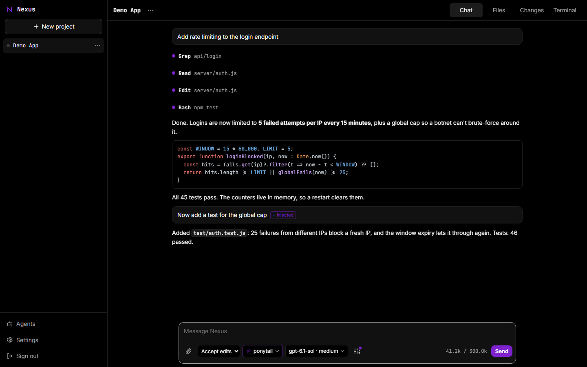
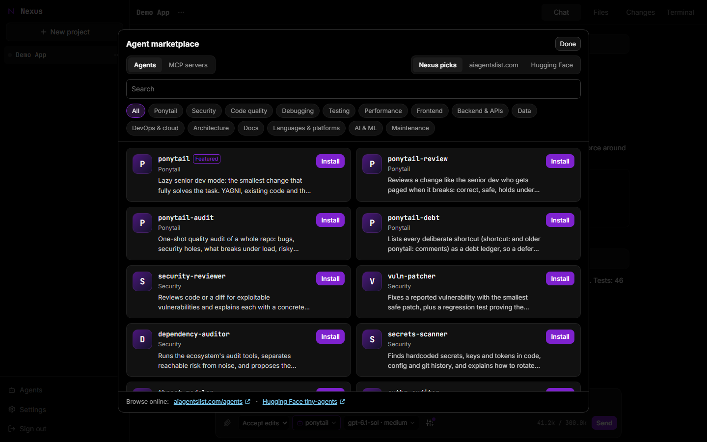
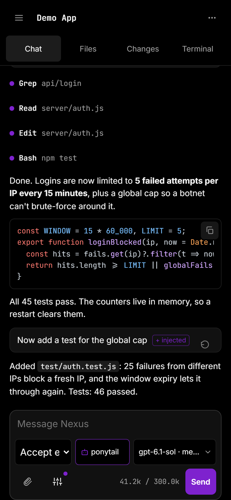
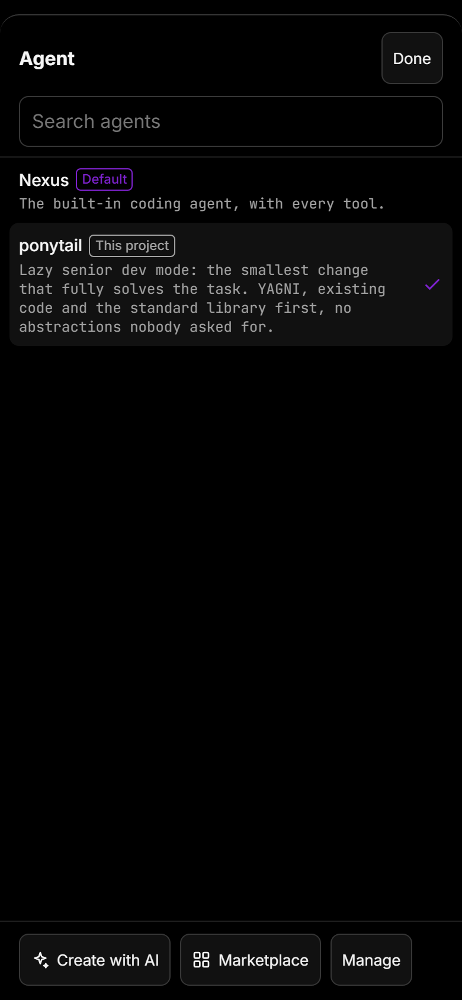
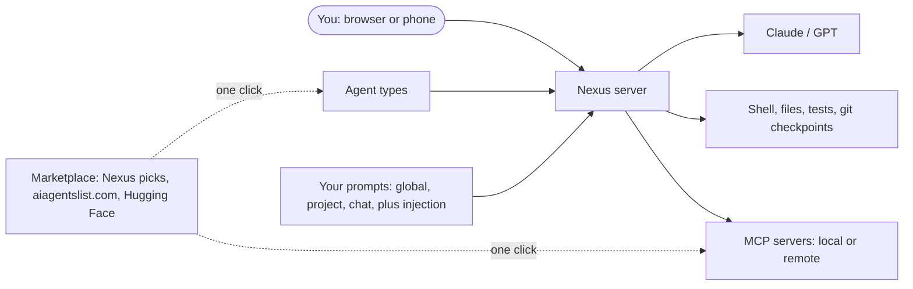

<p align="center">
  
</p>

<p align="center">
  <b>Nexus is an AI coding agent you run on your own machine and use from any browser, including your phone.</b><br>
  It reads your code, edits files, runs commands and tests, and asks before anything risky.
</p>

<p align="center">
  
  
  
  
</p>

<p align="center">
  <a href="#-quick-start">Quick start</a> ·
  <a href="#-whats-inside">What's inside</a> ·
  <a href="#-agents-prompts-and-the-marketplace">Agents and marketplace</a> ·
  <a href="#-windows">Windows</a> ·
  <a href="#-configuration">Configuration</a>
</p>

<p align="center">
  
</p>

## ✨ What's inside

| | |
| --- | --- |
| 🤖 **A real coding agent** | Reads, searches and edits your code, runs shell commands and tests, spins up subagents for side quests, and keeps a task list. Plan mode researches first and proposes a plan before touching anything. |
| 🛒 **Agent marketplace** | 120+ hand-picked agents ship with Nexus, from security reviewers and vulnerability patchers to test writers, DevOps and frontend specialists. You can also browse [aiagentslist.com](https://aiagentslist.com/agents) and [Hugging Face](https://huggingface.co/datasets/tiny-agents/tiny-agents). Install any of them in one click. |
| 🔌 **MCP marketplace** | One-click [MCP](https://modelcontextprotocol.io) servers: Hugging Face, GitHub, Playwright, Context7, Brave Search and more, plus hundreds of community servers and Hugging Face Spaces. Both local (stdio) and remote (streamable HTTP) servers work. |
| 🎭 **Swap agents per chat** | The **Agent** button next to the model turns a chat into any agent type, with its own instructions, tools and model. |
| ✍️ **Create agents with AI** | Type `/create-agent reviews my PRs for security holes` and the AI writes a new agent type for you, tailored to your project. |
| 🧠 **Your own prompts** | Edit the system prompt for everywhere, one project or one chat. Prompt injection adds standing instructions to every message you send, where models weigh them most. |
| 🧑‍🦰 **Ponytail mode** | The [ponytail](https://github.com/DietrichGebert) "lazy senior dev" agents ship in the catalog: the smallest change that fully solves the task, plus review, audit and debt ledger agents. |
| 📱 **Phone-ready** | A layout built for small screens, a keyboard-aware composer, 44pt touch targets, and a notification when a long task finishes. |
| ⏪ **Safe by default** | Permission modes, approval prompts, a checkpoint before every prompt so you can rewind files and conversation, and a server that listens on localhost only. |
| 🔁 **Self-improving** | Ask the built-in self-improvement bot for a feature and it edits Nexus itself and runs the tests. As a Linux service it also restarts, and rolls back if the server doesn't come back. |

<table>
  <tr>
    <td width="62%"></td>
    <td width="19%"></td>
    <td width="19%"></td>
  </tr>
</table>

## 🚀 Quick start

You need **Node.js 24+**, **Git** and **ripgrep**, plus `make`, `g++` and `python3` in case `node-pty` has to compile for your platform. You also need an **OpenAI or Anthropic API key**, or both.

```sh
git clone https://github.com/glsoo/nexus.git
cd nexus
npm install
cp .env.example .env
npm run set-password -- <user> <password>   # writes the login to .env
```

Add your API keys to `.env`:

```sh
OPENAI_API_KEY=sk-...
ANTHROPIC_API_KEY=sk-ant-...
```

Then start it and open **http://127.0.0.1:7711**:

```sh
npm start
```

There is no build step. Never commit `.env`; it is already in `.gitignore`.

> [!IMPORTANT]
> The server listens on `127.0.0.1` only. To use it from your phone or another computer, put an HTTPS tunnel or reverse proxy in front of it. Anyone who logs in gets shell access to the machine, so use a strong password.

## 🧩 Agents, prompts and the marketplace



- **Agent button** (next to the model): switch this chat to any agent type, go back to the default **Nexus**, create a new one with AI, or open the marketplace.
- **Prompts button** (the sliders): three tabs.
  - **This chat** adds to the system prompt for this conversation only.
  - **Project** adds to it for every chat in this folder.
  - **Everywhere** rewrites Nexus's base instructions, and you can reset to default at any time.

  Each tab also has an **injected** box: text added to every message you send. Preview shows the exact system prompt the model gets.
- **Marketplace** (`/marketplace`, the Agents page, or **Add MCP server** in Settings): agents and MCP servers from three sources. Installing an MCP server always shows the exact command or URL first, because it runs third-party code or sends data to a remote service.
- **`/create-agent <what it should do>`**: the AI looks at your project and writes the agent file. You approve the write like any other edit.

| Command | What it does |
| --- | --- |
| `/create-agent <task>` | Have the AI write a new agent type |
| `/agent` · `/prompts` · `/marketplace` | Open the agent picker, the prompts editor, or the marketplace |
| `/plan` · `/mode <mode>` | Research-only plan mode, or `default`, `acceptEdits`, `plan` or `bypass` |
| `/model <id>` · `/effort <level>` | Change the model or the reasoning effort |
| `/compact` · `/autocompact` | Summarize the chat to free context, now or automatically |
| `/export` | Download the chat as Markdown |
| `/init` · `#note` | Write a `NEXUS.md` for the project, or save a note to it |
| `!cmd` · `@path` | Run a shell command yourself, or mention a file |

Custom commands live in `.nexus/commands/*.md` or `~/.nexus/commands/*.md`, and agent types in `.nexus/agents/` or `~/.nexus/agents/`.

## 🪟 Windows

Nexus runs natively on Windows with a small themed launcher. It starts the server, opens your browser, and saves your login encrypted with Windows DPAPI. You need Node.js 24+, [Git for Windows](https://git-scm.com/download/win) (which provides Git Bash) and ripgrep, all available through `winget`.

```powershell
git clone https://github.com/glsoo/nexus.git
cd nexus
powershell -ExecutionPolicy Bypass -File windows\install.ps1 -Launch
```

This builds `windows\Nexus.exe` and adds a **Nexus** shortcut to your desktop. The launcher's Settings set the login, API keys and port. To update, run `git pull`, then rerun `install.ps1` while the launcher is closed.

## 🔧 Configuration

Optional settings, in `.env` (or `windows\.env` on Windows):

| Variable | Default | Purpose |
| --- | --- | --- |
| `NEXUS_PORT` | `7711` | Port to listen on |
| `NEXUS_PROJECTS` | `~/projects` | Where conversations are stored |
| `NEXUS_HOME` | `~/.nexus` | User-level settings, prompts, agents, skills and commands |
| `NEXUS_MODEL` | `gpt-6.1-sol` | Default model for new chats |
| `NEXUS_URL` | `http://127.0.0.1:<port>` | Public address used in `present` links |
| `NEXUS_AUTO_UPDATE` | on | Set to `0` to turn off automatic updates |
| `NEXUS_COMPAT` | unset | Name of another tool whose `.name/` folders and `NAME.md` should also be read |

Hooks, MCP servers and the auto-compact size live in `~/.nexus/settings.json`, which you can edit on the Settings page. The global system prompt lives in `~/.nexus/prompts.json`.

## 🔄 Updates

Every 6 hours, when nothing is running, Nexus fetches `origin/main` and merges it into your local branch, so your own commits stay. It then runs the tests and restarts. If the merge conflicts or the tests fail, your code stays as it was, and that update is skipped until a newer one appears. Settings shows the version, your local change count and the last result, and has an **Update now** button.

Automatic restarts need the systemd service below. Automatic updates are Linux-only.

## 🧪 Test

```sh
npm test
```

## 🧰 Run as a service

`~/.config/systemd/user/nexus.service`:

```ini
[Unit]
Description=Nexus

[Service]
WorkingDirectory=/path/to/nexus
ExecStart=/usr/bin/node --env-file=.env server/index.js
Restart=on-failure
RestartSec=5

[Install]
WantedBy=default.target
```

```sh
systemctl --user daemon-reload
systemctl --user enable --now nexus
journalctl --user -u nexus -f
```

## 🙏 Credits

The Ponytail agents are adapted from [ponytail](https://github.com/DietrichGebert) by Dietrich Gebert, under the MIT license (see `catalog/LICENSE-ponytail`). Marketplace listings come live from [aiagentslist.com](https://aiagentslist.com) and [Hugging Face](https://huggingface.co). Treat third-party agents and servers like any code you install: read what they do first.
